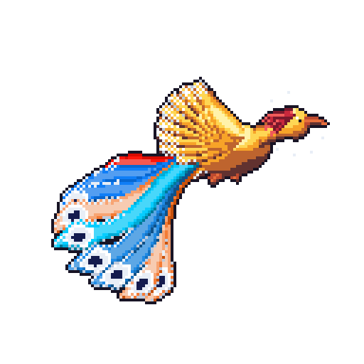
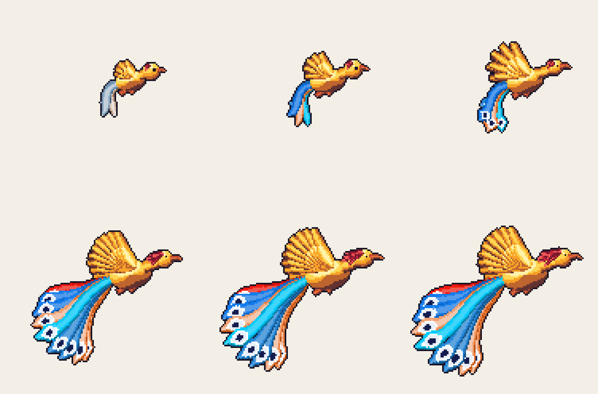
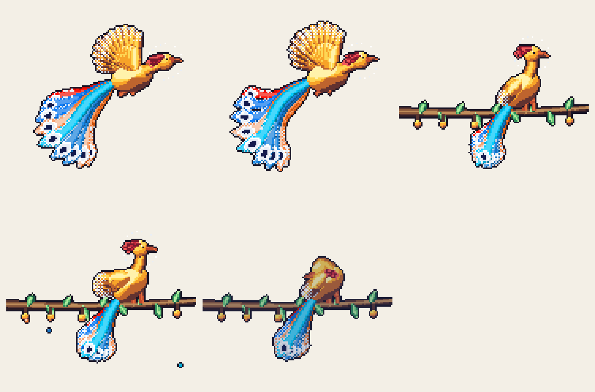
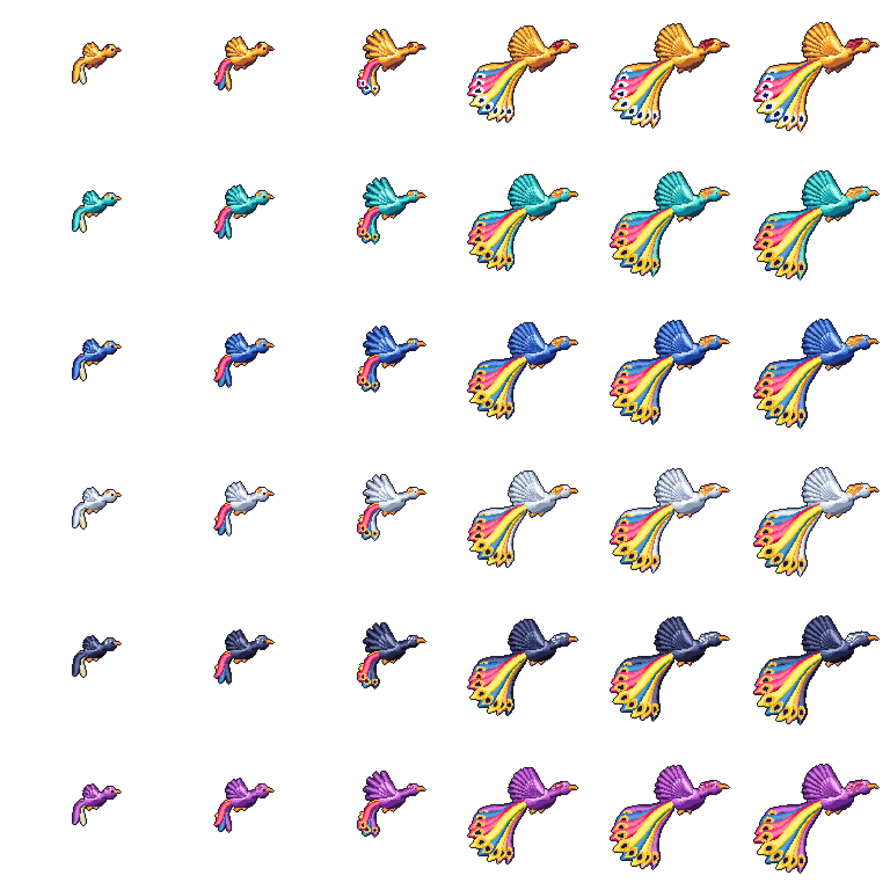
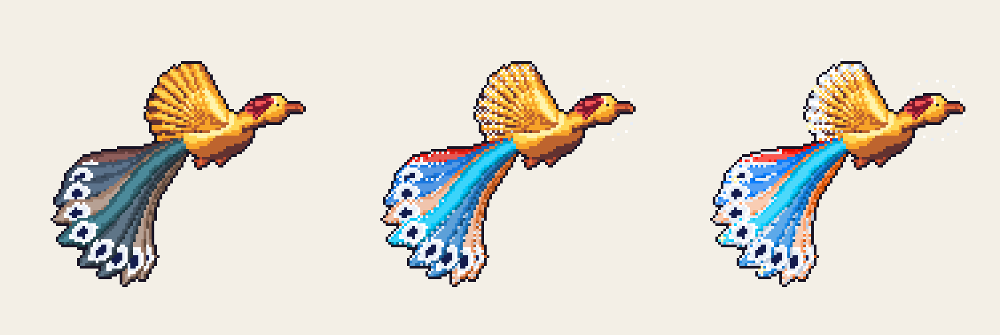

<div dir="rtl" align="center">

# 🪶 سیمرغ

**سیمرغی پیکسلی که با فعالیت گیت‌هاب شما بزرگ می‌شود.**

فارسی · [English](README.md)



</div>

---

<div dir="rtl" align="right">

## این پروژه چیست؟

سیمرغ **فعالیت عمومی یک حساب گیت‌هاب** را می‌خواند و از روی آن یک
[سیمرغ](https://fa.wikipedia.org/wiki/سیمرغ) پیکسلی می‌کشد، به‌شکل GIF حلقه‌ای
برای README پروفایل شما. هیچ‌چیز دستی کشیده نمی‌شود: زبان‌هایی که با آن‌ها کد
می‌نویسید رنگ پرهای دُم را می‌سازند، تعداد مشارکت‌ها آن را از یک جوجه به
پرنده‌ای تاج‌دار می‌رسانند، استریک‌هایتان «فَرّ» زرین را دورش روشن می‌کنند، و
کاری که دیروز کرده‌اید تعیین می‌کند امروز چطور حرکت کند.

این پروژه هم یک **GitHub Action** آماده است، هم یک **ابزار خط فرمان**، و هم یک
**کتابخانهٔ Rust**، همه در یک مخزن. آن را فورک کنید، سیمرغ را مال خودتان کنید و
روی پروفایلتان بگذارید.

## چرا سیمرغ؟

ایدهٔ اصلی از پروژهٔ [git-koi](https://github.com/yalongwastaken/git-koi) ساختهٔ
**Anthony Yalong** آمده است که فعالیت یک حساب گیت‌هاب را به یک ماهی کوی پیکسلی
تبدیل می‌کند. سیمرغ فورکی از آن است: خط لولهٔ داده، GitHub Action و ابزار خط
فرمان با مجوز MIT از git-koi گرفته شده‌اند و به‌جای ماهی، موجودی از فرهنگ ایران
نشسته است. پرنده، پرهایش و حرکتش تازه نوشته شده‌اند.

این ریپو با هدف ایجاد فرصتی برای **نمایش هویت ایرانی در محیط‌های کار گروهی مانند
گیت‌هاب** شکل گرفته است: تکه‌ای کوچک و زنده از اسطورهٔ ایران که هر کسی می‌تواند
روی پروفایلش بگذارد. امیدوارم میان هم‌وطنان و فارسی‌زبانان، و همچنین سایر
کاربران گیت‌هاب که فقط از این ایده خوششان می‌آید، مورد توجه قرار بگیرد.

## فعالیت شما چطور به پرنده تبدیل می‌شود؟

| از حساب گیت‌هاب           | روی سیمرغ                                                                                                                                   |
| ------------------------- | ------------------------------------------------------------------------------------------------------------------------------------------- |
| زبان‌های برنامه‌نویسی     | رنگ پرهای دُم، به نسبت سهم هر زبان                                                                                                          |
| مجموع مشارکت‌ها           | رشد، از جوجه تا پرنده‌ای تاج‌دار (پایین‌تر ببینید)                                                                                          |
| استریک جاری               | «فَرّ» زرین: هاله‌ای از نور دور سر و طلا روی نوک بال‌ها و لبهٔ دُم. در ۱۳ هفته کامل می‌شود و بعد از پایان استریک در حدود شش هفته محو می‌شود |
| بلندترین استریک           | شدت رنگ زبان‌ها: ابتدا کدر، در ۴ هفته عادی، در ۵۲ هفته پرجلوه. رکورد چهارساله روی پرها جرقه می‌افزاید                                       |
| روزی که همین الان تمام شد | کاری که سیمرغ امروز می‌کند (پایین‌تر ببینید)                                                                                                |

همه‌چیز قطعی (deterministic) است: یک حساب در یک روز همیشه یک تصویر می‌دهد، و یک
دانهٔ ثابت جزئیات کوچک پرها را تعیین می‌کند، پس رشد آن‌ها را عوض نمی‌کند.

## مراحل رشد سیمرغ

<p align="center"></p>

تصاویر از چپ به راست و از بالا به پایین، به ترتیب همین مراحل جدول‌اند.

| مشارکت‌ها | مرحله                                                                                     |
| --------- | ----------------------------------------------------------------------------------------- |
| ۰         | **جوجه.** سر گرد، بدن کوچک، بال‌های کوتاه و سه پر کوتاه دُم، با رنگ‌های کم‌رنگ.           |
| ۵۰۰       | **نوپر.** رنگ زبان‌ها به قدرت کامل می‌رسد.                                                |
| ۱٬۵۰۰     | **پرندهٔ جوان.** تناسب بزرگسال و دُمی بلندتر؛ پرهای دُم حالا به «چشم» طاووسی ختم می‌شوند. |
| ۱۲٬۷۵۰    | **بزرگسال.** شکل کامل: نه پر دُم، هشت پر بال و تاجی پنج‌پری.                              |
| ۵۰٬۰۰۰    | **سیمرغ بزرگ.** پرنده همچنان درشت‌تر می‌شود و دُم و تاجش بلندتر.                          |
| ۱۰۰٬۰۰۰   | **بزرگ‌ترین شکل.** رشد همین‌جا متوقف می‌شود.                                              |

رشد لگاریتمی است: مشارکت‌های اول پرنده را سریع عوض می‌کنند و بعدی‌ها آهسته.

## هر روز چه می‌کند؟

<p align="center"></p>

حرکت سیمرغ از روی روزی که تازه تمام شده انتخاب می‌شود:

| رفتار                      | چه وقت                                                                                                                                  |
| -------------------------- | --------------------------------------------------------------------------------------------------------------------------------------- |
| **پرواز آرام** (Glide)     | هر روز معمولی: بال‌زدن آرام و دُمی که نرم جاری است                                                                                      |
| **اوج‌گیری** (Soar)        | تا یک هفته بعد از رسیدن مجموع به ۱k، ۵k، ۱۰k، ۲۵k، ۵۰k یا ۱۰۰k، یا یکشنبه‌ای که هفته‌ای درخشان را تمام می‌کند: بال‌زدن تند و دُمی گشاده |
| **ریختن دانه** (Seed fall) | اولین روز فعال هفته: سیمرغ «درخت همه‌تخمه» (گوکرد) را تکان می‌دهد و دانه‌ها به رنگ زبان‌های شما می‌ریزند                                |
| **نشستن** (Perch)          | ۱۴ روز یا بیشتر بی‌فعالیتی: بال‌های بسته روی شاخه و نگاه به اطراف                                                                       |
| **خواب** (Sleep)           | ۶۰ روز یا بیشتر بی‌فعالیتی: سر زیر بال، چشم بسته، کم‌نور و مایل به آبی                                                                  |

## رنگ‌بندی‌ها (Body)

شش رنگ‌بندی، رنگ سینه، بال‌ها، تاج و منقار را تعیین می‌کنند. دُم همیشه رنگ
زبان‌های شما را نگه می‌دارد. با گزینهٔ `body` یکی را انتخاب کنید.

<picture>
  <source media="(prefers-color-scheme: dark)" srcset="docs/bodies-dark.png" />
  
</picture>

| رنگ‌بندی           | رنگ‌ها           |
| ------------------ | ---------------- |
| `zarrin` (پیش‌فرض) | زرین، با تاج سرخ |
| `firuzeh`          | فیروزه‌ای        |
| `lajvard`          | آبی لاجورد       |
| `sepid`            | سپید نقره‌ای     |
| `shab`             | آبی تیرهٔ شب     |
| `arghavan`         | ارغوانی          |

## فَرّ

درخشش زرین استریک جاری. از چپ: بدون استریک، استریک شش‌هفته‌ای و رکورد بلند.

<p align="center"></p>

## شروع سریع

### روی پروفایل گیت‌هاب (با Action)

1. **مخزن پروفایل** بسازید: مخزنی که نامش دقیقاً مثل نام کاربری شماست.
2. یک ورک‌فلو مثل `.github/workflows/simurgh.yml` بگذارید و از
   [`examples/profile-workflow.yml`](examples/profile-workflow.yml) به‌عنوان
   الگو استفاده کنید. هر شب اجرا می‌شود، سیمرغ را در پوشهٔ `simurgh/` می‌کشد و
   نتیجه را کامیت می‌کند.
3. آن را در `README.md` پروفایلتان نشان دهید:

   ```markdown
   
   ```

ورک‌فلو فقط از `github.token` داخلی استفاده می‌کند، پس **هیچ رمز یا توکنی لازم
نیست بسازید یا جایی بچسبانید**.

### روی خط فرمان

به Rust (نسخهٔ `rust-version` در [`Cargo.toml`](Cargo.toml)) و
[GitHub CLI](https://cli.github.com) نیاز دارید، با `gh auth login` وارد شده
باشید.

```sh
cargo run --release -- collect <نام-کاربری-شما> --output snapshot.json
cargo run --release -- render snapshot.json --output-dir simurgh --body lajvard
```

فایل `simurgh/preview.html` را باز کنید تا نتیجه را روی پس‌زمینهٔ روشن و تیره
ببینید.

راهنمای کامل، از جمله کتابخانهٔ Rust و **مراحل گام‌به‌گام انتشار نسخهٔ خودتان از
این پروژه روی گیت‌هاب**، در
[`docs/getting-started.fa.md`](docs/getting-started.fa.md) است.

## مال خودتان کنید

این مخزن **هیچ نام، توکن یا رمز شخصی‌ای** در خود ندارد، پس هر فورکی همین‌طور کار
می‌کند. برای شخصی‌سازی:

1. مخزن را **فورک** کنید یا از آن به‌عنوان قالب (template) استفاده کنید.
2. در [`LICENSE`](LICENSE) اعلان اصلی را نگه دارید و سطر خودتان را اضافه کنید.
3. در [`Cargo.toml`](Cargo.toml) مقدار `name` را عوض کنید (و اگر منتشر می‌کنید،
   `repository` را بگذارید).
4. در ورک‌فلوی خودتان `uses:` را به **نسخهٔ خودتان** از این مخزن و یک تگ انتشار
   اشاره دهید. Action مخزن خودش را خودش پیدا می‌کند و چیز دیگری لازم نیست ویرایش
   شود.
5. ظاهر را عوض کنید:
   - رنگ‌ها و رنگ‌بندی‌ها: [`src/coat.rs`](src/coat.rs)
   - کالبد و نقاشی: [`src/render.rs`](src/render.rs)
   - حرکت: [`src/motion.rs`](src/motion.rs)
   - زمان هر رفتار: [`src/behavior.rs`](src/behavior.rs)
6. تصاویر همین README را دوباره بسازید:

   ```sh
   cargo run --release --example generate-docs -- docs
   cargo run --release --example generate-library -- library
   ```

انتشار روی crates.io به‌طور پیش‌فرض خاموش است. برای روشن کردنش متغیر مخزن
`PUBLISH_TO_CRATES_IO` را روی `true` بگذارید و انتشار مورد اعتماد (trusted
publishing) را آنجا تنظیم کنید.

## ساختار مخزن

```text
.
├── .github/      ورک‌فلوها، فرم‌های issue و Dependabot
├── docs/         راهنماها و تصاویر نمایش‌داده‌شده در اینجا
├── examples/     ورک‌فلوی پروفایل و مولدهای تصویر
├── src/          کتابخانه و دستور simurgh
├── tests/        تست‌ها و داده‌های آزمایشی
└── action.yml    GitHub Action
```

## نویسنده

**شروین شکوهی** (Shervin Shokouhi) ·
[لینکدین](https://www.linkedin.com/in/shervin-shokouhi/)

ایدهٔ اصلی و پایهٔ کد: [git-koi](https://github.com/yalongwastaken/git-koi)
ساختهٔ Anthony Yalong.

## مجوز

MIT. فایل [`LICENSE`](LICENSE) را ببینید. اعلان کپی‌رایت اصلی git-koi، همان‌طور
که مجوز الزام می‌کند، نگه داشته شده است.

</div>
