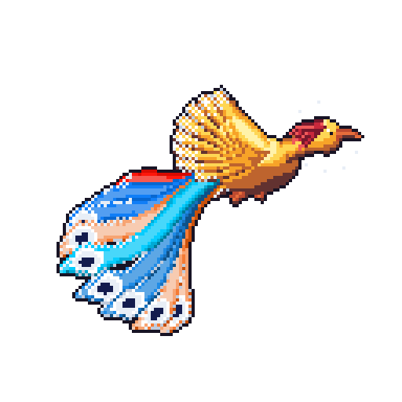
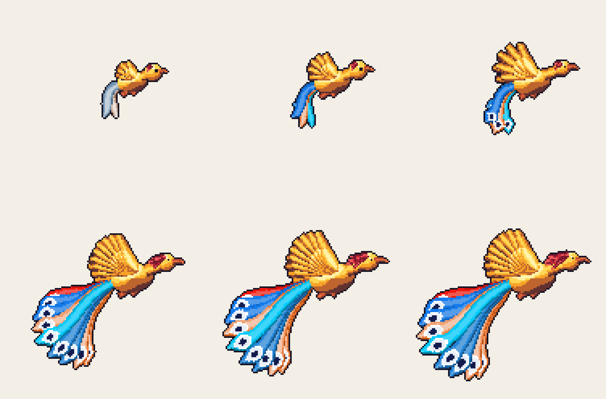
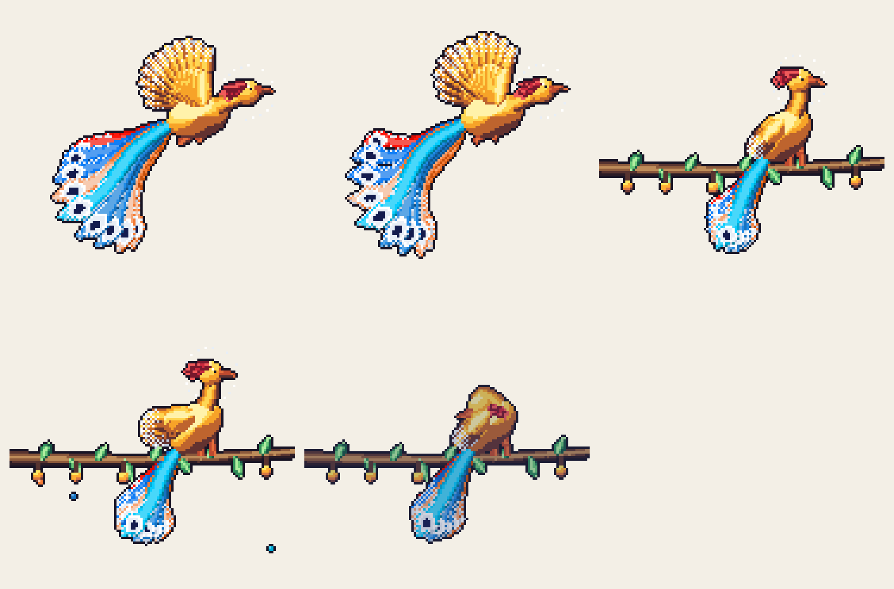
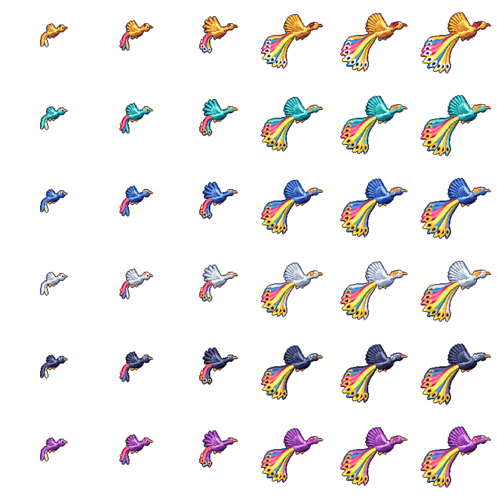
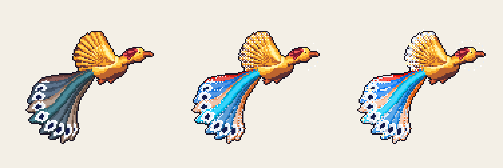

<div align="center">

# 🪶 Simurgh

**A pixel-art Simurgh that grows from your GitHub activity.**

English · [فارسی](README.fa.md)



</div>

---

## What is this?

Simurgh reads the **public activity of a GitHub account** and draws a pixel-art
[Simurgh](https://en.wikipedia.org/wiki/Simurgh), the great bird of Persian myth,
as a looping GIF for your profile README. Nothing is drawn by hand: the languages
you write color its tail, your contributions grow it from a chick into a crowned
bird, your streaks light the golden *farr* around it, and what you did yesterday
decides how it moves today.

It is a ready-to-use **GitHub Action**, a **command-line tool**, and a **Rust
library**, all in one repository. Fork it, make the bird your own, and put it on
your profile.

## Why Simurgh?

The idea comes from [git-koi](https://github.com/yalongwastaken/git-koi) by
**Anthony Yalong**, which turns a GitHub account's activity into a pixel-art koi.
Simurgh is a fork of it: the data pipeline, the GitHub Action, and the command line
come from git-koi under the MIT license, and the fish is replaced by a creature of
Persian culture. The bird, its plumage, and its motion are new.

This repository was created to give **Iranian identity a place to be seen in
collaborative spaces like GitHub**: a small, living piece of Iranian myth that anyone
can wear on their profile. I hope it finds its way to my fellow Iranians and
Persian speakers, and to other GitHub users who simply like the idea.

## How your activity becomes a bird

| From the account | On the Simurgh |
| --- | --- |
| Languages | The colors of the tail streamers, shared out by each language's share |
| Total contributions | Growth, from a chick to a crowned bird (see below) |
| Current streak | The golden **farr**: a halo of light around the head, and gold on the wing tips and tail rims. It is full at 13 weeks and fades over about six weeks once the streak ends |
| Longest streak | How vivid the language colors are: dull at first, normal at 4 weeks, vivid at 52 weeks. A record of four years adds a sparkle to the plumage |
| The day that just ended | What the Simurgh does today (see below) |

Everything is deterministic: the same account on the same day always gives the same
picture, and a fixed seed decides the small details of the feathers, so growth never
rerolls them.

## Stages of growth

<p align="center"></p>

The pictures run left to right, top to bottom.

| Contributions | Stage |
| --- | --- |
| 0 | **Chick.** A round head, a small body, short wings, and three short tail feathers in pale colors. |
| 500 | **Fledgling.** The language colors reach full strength. |
| 1,500 | **Young bird.** Adult proportions and a longer tail; the tail streamers now end in eye-spots, like a peacock's. |
| 12,750 | **Adult.** The full form: nine tail streamers, eight wing feathers, a five-feather crest. |
| 50,000 | **Great Simurgh.** The bird keeps growing in size, and the tail and crest keep lengthening. |
| 100,000 | **The largest form.** Growth stops here; more contributions change nothing. |

Growth is logarithmic, so the first contributions change the bird quickly and later
ones slowly.

## What it does each day

<p align="center"></p>

The Simurgh's movement is chosen from the day that just ended:

| Behavior | When |
| --- | --- |
| **Glide** | Any ordinary day: slow wingbeats and a gently flowing tail |
| **Soar** | Within a week after your total crosses 1k, 5k, 10k, 25k, 50k, or 100k, or on a Sunday that finishes a standout week: fast wingbeats and a wide, sweeping tail |
| **Seed fall** | The first active day of the week: the Simurgh shakes the Tree of All Seeds (*Gokard*) and seeds fall, in your language colors |
| **Perch** | 14 or more quiet days: wings folded on the branch, looking about |
| **Sleep** | 60 or more quiet days: head tucked, eye shut, dimmed and tinted blue |

## Bodies

Six bodies set the color of the breast, wings, crest, and beak. The tail always keeps
your language colors. Choose one with the `body` option.

<picture>
  <source media="(prefers-color-scheme: dark)" srcset="docs/bodies-dark.png" />
  
</picture>

| Body | Colors |
| --- | --- |
| `zarrin` (default) | Gold, with a crimson crest |
| `firuzeh` | Turquoise |
| `lajvard` | Lapis lazuli blue |
| `sepid` | Silver white |
| `shab` | The deep blue of night |
| `arghavan` | Judas-tree purple |

## The farr

The golden glow of the current streak. Left to right: no streak, a six-week streak,
and a long record.

<p align="center"></p>

## Quick start

### On your GitHub profile (the Action)

1. Create your **profile repository**: a repository named exactly like your username.
2. Add a workflow such as `.github/workflows/simurgh.yml`, using
   [`examples/profile-workflow.yml`](examples/profile-workflow.yml) as the template.
   It runs nightly, draws the Simurgh into `simurgh/`, and commits the result.
3. Show it in your profile `README.md`:

   ```markdown
   
   ```

The workflow uses only the built-in `github.token`, so there is **no secret to
create or paste anywhere**.

### On the command line

You need Rust (see `rust-version` in [`Cargo.toml`](Cargo.toml)) and the
[GitHub CLI](https://cli.github.com), signed in with `gh auth login`.

```sh
cargo run --release -- collect <your-username> --output snapshot.json
cargo run --release -- render snapshot.json --output-dir simurgh --body lajvard
```

Open `simurgh/preview.html` to see the result on light and dark backgrounds.

The full guide, including the Rust library and **how to publish your own copy of this
project on GitHub step by step**, is in
[`docs/getting-started.md`](docs/getting-started.md).

## Make it yours

This repository holds **no personal name, token, or password**, so a fork works as it
is. To make it your own:

1. **Fork** the repository, or use it as a template.
2. In [`LICENSE`](LICENSE), keep the original notice and add your own line.
3. In [`Cargo.toml`](Cargo.toml), change `name` (and set `repository` if you publish).
4. In your workflow, point `uses:` at **your** copy of this repository, at a release
   tag. The Action finds its own repository, so nothing else needs editing.
5. Change the look:
   - Colors and bodies: [`src/coat.rs`](src/coat.rs)
   - Anatomy and drawing: [`src/render.rs`](src/render.rs)
   - Motion: [`src/motion.rs`](src/motion.rs)
   - When each behavior happens: [`src/behavior.rs`](src/behavior.rs)
6. Regenerate the pictures in this README:

   ```sh
   cargo run --release --example generate-docs -- docs
   cargo run --release --example generate-library -- library
   ```

Publishing to crates.io is off by default. To turn it on, set the repository
variable `PUBLISH_TO_CRATES_IO` to `true` and configure trusted publishing there.

## Repository structure

```text
.
├── .github/      workflows, issue forms, and Dependabot
├── docs/         the guides and the pictures shown here
├── examples/     the profile workflow and the picture generators
├── src/          the library and the simurgh command
├── tests/        the tests and their fixtures
└── action.yml    the GitHub Action
```

## Author

**Shervin Shokouhi** (شروین شکوهی) · [LinkedIn](https://www.linkedin.com/in/shervin-shokouhi/)

Original idea and code base: [git-koi](https://github.com/yalongwastaken/git-koi) by
Anthony Yalong.

## License

MIT. See [`LICENSE`](LICENSE). The original git-koi copyright notice is kept, as the
license requires.
